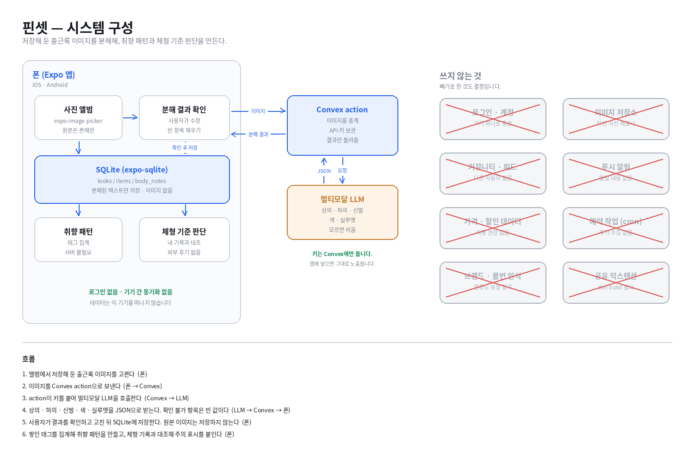

# System Design — 핀셋 (pinset)

## Overview

폰에서 도는 Expo 앱 하나와, 이미지 분해 요청을 중계하는 Convex action 하나로 이루어집니다.

저장해 둔 출근룩 이미지를 분해하려면 멀티모달 LLM을 호출해야 하고, 그 호출에는 API 키가 필요합니다. 키를 앱에 넣으면 그대로 노출되므로 서버가 필요합니다. Convex action은 그 한 가지 일만 합니다. 거래 데이터에 해당하는 분해 결과는 전부 폰의 SQLite에 저장하므로, Convex에는 아무것도 쌓이지 않습니다.

취향 패턴과 체형 기준 판단은 저장된 태그를 집계하는 일이라 서버 없이 폰에서 계산합니다.

## Diagram

## Core flow

1. 앨범에서 저장해 둔 출근룩 이미지를 고른다 — 폰 (`expo-image-picker`)
2. 이미지를 Convex action으로 보낸다 — 폰 → Convex
3. action이 환경변수의 키를 붙여 멀티모달 LLM을 호출한다 — Convex → LLM
4. 상의·하의·신발·색·실루엣을 JSON으로 받는다. 확인할 수 없는 항목은 빈 값이다 — LLM → Convex → 폰
5. 사용자가 결과를 확인하고 고친 뒤 SQLite에 저장한다. 원본 이미지는 저장하지 않는다 — 폰
6. 쌓인 태그를 집계해 취향 패턴을 만들고, 체형 기록과 대조해 주의 표시를 붙인다 — 폰

## Data

데이터는 전부 폰의 SQLite(`expo-sqlite`)에 둡니다. 원본 이미지는 저장하지 않고, 분해된 텍스트만 남깁니다.

**looks** — 분해한 착장 한 벌
`id, createdAt, sourceHint, silhouette, dressCode, memo`

**items** — 착장을 이루는 아이템
`id, lookId, slot(top/bottom/shoes), category, color, fit, length, material, confidence(확실/추정/확인불가)`

**body_notes** — 본인 체형과 과거 기록
`id, kind(체형/실패/성공), silhouette, note`

**키: looks는 `id`, items는 `(lookId, slot)`.**
한 착장에 상의·하의·신발이 각각 하나씩이므로, 같은 착장의 같은 자리는 같은 행입니다. 레이어드는 별도 행이 아니라 상의 행의 속성으로 둡니다. 그래야 같은 사진을 두 번 넣어도 중복이 생기지 않습니다.

`AsyncStorage`는 본인 체형 입력을 마쳤는지 같은 설정값에만 씁니다. `SecureStore`는 쓰지 않습니다. 앱이 보관할 비밀 값이 없기 때문입니다.

## Data sources

**① 저장해 둔 이미지 — 폰 기능 (사진 앨범 권한)**

`expo-image-picker`로 앨범에서 고릅니다. Expo Go에서 동작하므로 development build가 필요 없습니다. 가져오는 시점은 사용자가 요청할 때뿐이고, 앱이 앨범을 훑지 않습니다.

한계: 인스타그램이나 핀터레스트 앱 안의 저장함에는 접근할 수 없습니다. 사용자가 스크린샷을 찍어 앨범에 둔 것만 가져올 수 있습니다. 공유 익스텐션을 만들면 해결되지만 development build가 필요해 이번 범위에서 제외했습니다.

**② 이미지 분해 — 멀티모달 LLM**

실제로 한 번 불러본 결과: `docs/samples/decompose-sample.json`

출근룩 이미지 4장을 넣어 확인했습니다. 상의·하의의 종류와 색, 실루엣은 4/4 정확했습니다. 신발은 2/4만 가능했고, 바지에 가리거나 프레임 밖인 경우 판단할 수 없었습니다. 소재는 0/4로, 어느 장에서도 확정하지 못했습니다. 역광에서는 어두운 상의의 조직이 날아갔습니다.

이 결과를 보고 설계를 바꿨습니다. **확인할 수 없는 항목은 지어내지 않고 빈 값으로 돌려받아, 사용자가 채우게 합니다.** `confidence` 필드가 그래서 생겼습니다.

한계: 아직 API 키가 없어 수동 호출로 확인했습니다. 앱에서는 같은 요청을 Convex action이 보냅니다. 호출당 비용이 들고, 네트워크가 없으면 분해할 수 없습니다.

막히면: 분해 정확도가 실사용에서 더 낮으면, 자동 분해를 빼고 사용자가 태그를 직접 고르는 형태로 좁힙니다. 취향 패턴과 체형 판단은 태그만 있으면 그대로 동작합니다.

**③ 체형 기록 — 사용자 입력**

본인이 한 번 입력합니다. 외부에서 가져오지 않습니다.

비슷한 체형인 사람들의 후기를 모아 보여주는 방식도 검토했지만, 무신사·29CM·지그재그의 공개 자료에서 외부 앱이 리뷰 데이터를 가져와 재표시할 권한은 확인하지 못했습니다. 크롤링은 데이터베이스권과 부정경쟁방지법 문제가 있어 선택지에서 제외했습니다.

## Decisions

### 이미지 분해는 Convex action을 거친다

| | |
|---|---|
| 선택지 | 앱에서 LLM 직접 호출 · Convex action 경유 · 기기 내 모델 |
| 고른 것 | Convex action 경유 |
| 이유 | API 키를 앱에 넣으면 그대로 노출됩니다. `EXPO_PUBLIC_`으로 시작하는 값은 빌드에 포함됩니다. 기기 내 모델은 Expo Go에서 돌지 않고 development build가 필요합니다. |
| 대가 | 네트워크가 없으면 분해할 수 없고, 호출마다 비용이 듭니다. |

### 분해 결과만 저장하고 원본 이미지는 폰에 둔다

| | |
|---|---|
| 선택지 | 원본을 서버에 저장 · 원본을 폰에만 두고 텍스트만 저장 |
| 고른 것 | 텍스트만 저장 |
| 이유 | 입력 이미지는 대부분 타인의 사진입니다. 서버에 올려 다시 보여주면 권리 문제가 생깁니다. 텍스트 분해 결과에는 그 문제가 없고, 취향 패턴과 체형 판단에는 텍스트만 있으면 충분합니다. |
| 대가 | 폰에서 원본을 지우면 어떤 사진이었는지 다시 볼 수 없습니다. 기기를 바꾸면 데이터가 사라집니다. |

### iOS와 Android 둘 다 내되, Expo Go 범위 안에서만 만든다

| | |
|---|---|
| 선택지 | 한쪽만 · 둘 다 (Expo Go) · 둘 다 (development build) |
| 고른 것 | 둘 다, Expo Go 범위 |
| 이유 | 이번 기능은 앨범 접근과 네트워크 호출뿐이라 Expo Go에서 전부 됩니다. development build를 쓰면 빌드 환경을 두 플랫폼에 각각 갖춰야 하는데, 1인 3주에서 그 시간을 쓸 이유가 없습니다. |
| 대가 | 공유 익스텐션과 기기 내 모델을 쓸 수 없습니다. 그래서 인스타그램에서 바로 보내는 흐름을 포기하고 앨범에서 고르는 방식으로 좁혔습니다. |
| 위험 | iOS 베타 배포에는 Apple Developer 계정과 TestFlight 첫 빌드 심사가 필요합니다. 아직 계정이 없어, 이것이 11/20 배포의 가장 큰 일정 위험입니다. 11월 첫 주에 가입을 끝냅니다. |
